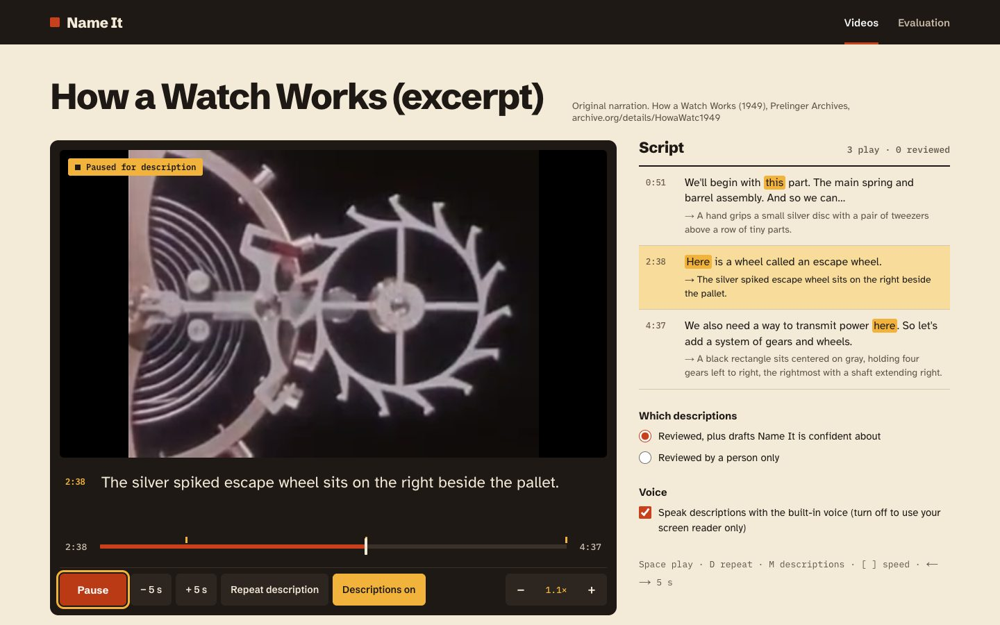
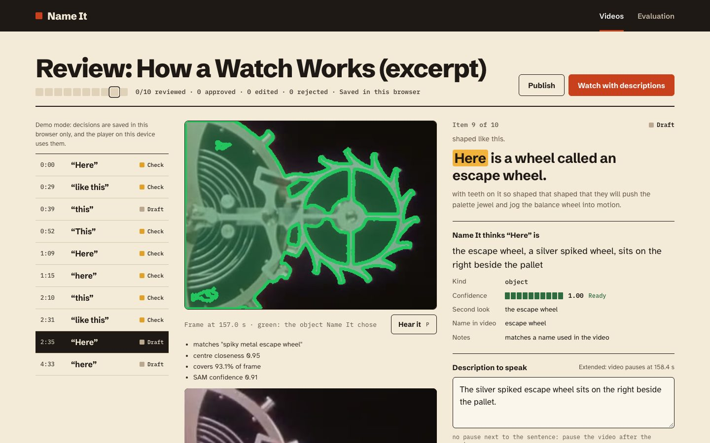
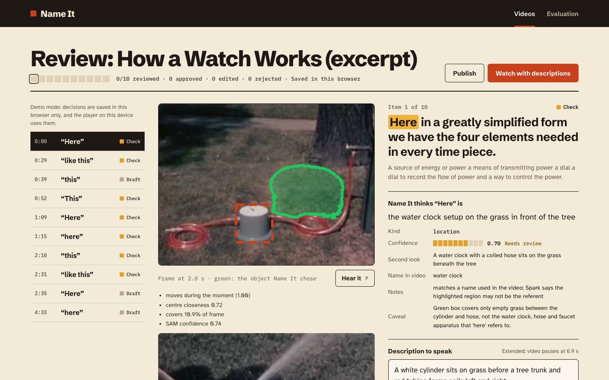
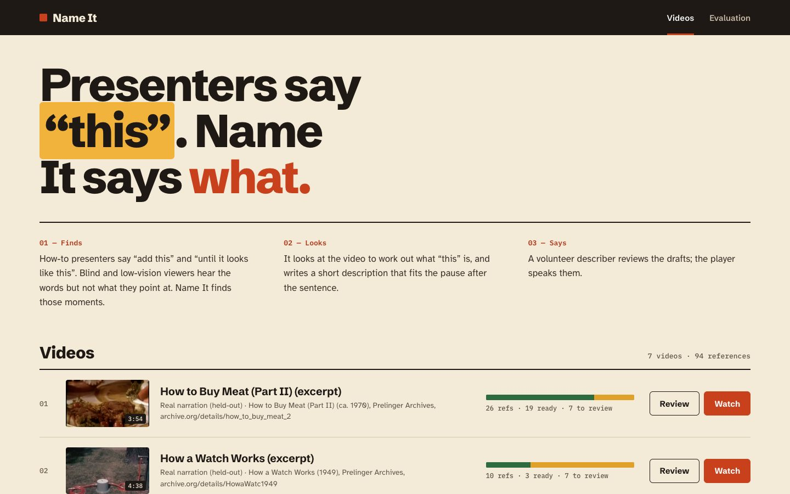
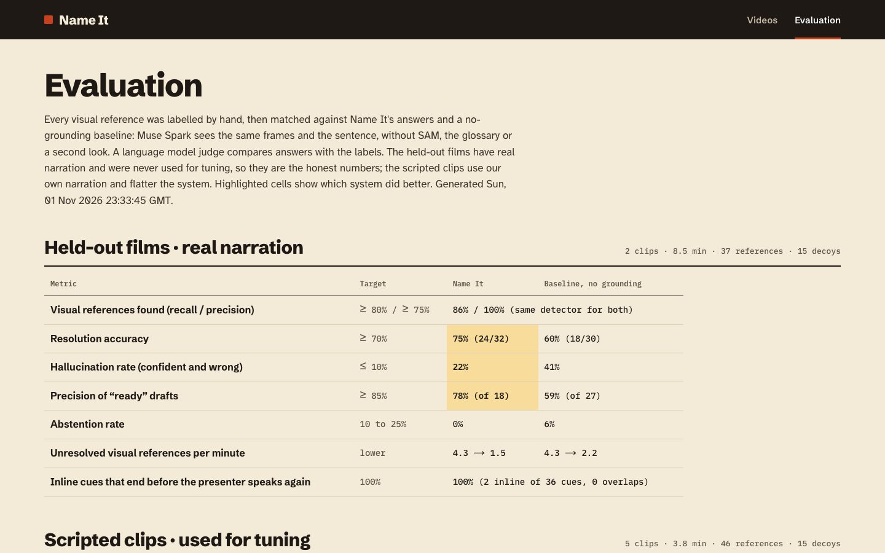

# Name It

Name It tells blind and low vision viewers what “this” is.

How-to presenters point and say “add this”, “about this much”, “until it looks like this”. If you can't see the screen, you hear the words but not the thing. Name It finds those moments in a video, looks at the frames to work out what “this” is, and writes a short audio description that fits into the pause after the sentence. A volunteer describer checks the drafts, and an accessible player reads them out.

Live demo: https://name-it-rho.vercel.app



## Why I made this

Try watching a cooking video with your eyes closed. “Now add this, then mix until it looks like this.” Add what? Looks like what?

Researchers counted these visual references in online videos and found a median of about 2.5 a minute (Liu et al., CHI 2021). Human audio description fixes it, but there aren't nearly enough describers: only about 7% of videos requested on YouDescribe get described. AI describers exist, but they tend to describe the whole scene and stay vague about the exact tool or ingredient. And when they don't know, they guess.

So Name It does one narrow thing well: it resolves the specific word the presenter said, shows the evidence for its answer, and flags it for a person when it isn't sure.

## What it does

- **Finds the references.** Every “this”, “that”, “here”, “like this”, “these” in the transcript. A model decides which ones point at something on screen and which don't (“this recipe is easy” doesn't).
- **Finds the moment.** The presenter often shows the thing just after saying the word, so it picks the frame that shows it best.
- **Finds the object.** SAM 3.1 tracks every candidate object for 3 seconds, and Name It picks the one the hand is touching or moving. The reasons are kept so a person can check them.
- **Names it** the way the presenter does. “The walnuts”, not “brown objects in a jar”, because it reads the whole transcript first.
- **Knows when it doesn't know.** Two independent looks, SAM's own score and a check of whether the box really is the thing are combined into a confidence. Low ones go to a person instead of being spoken.
- **Fits the gaps.** Short descriptions are spoken in the pause after the sentence with the video turned down. If there's no room, the video pauses, the description plays, and it carries on.
- **Review queue for describers.** Approve, edit or reject each draft by keyboard (A, E, R, J, K), with the evidence frame and mask in front of you.
- **Accessible player.** Keyboard controls, adjustable speed, descriptions mirrored to screen readers, and a recorded description voice (ElevenLabs) with the browser voice as a fallback.

## Screenshots

**Review.** The highlighted word, what Name It thinks it is, the evidence and how confident it is.



**Flagged for a person.** Here SAM outlined empty grass instead of the water clock. Name It noticed, said so, and sent it for review instead of speaking it.



**Videos.** Five scripted demo clips and two real instructional films from the 1940s and 70s.



**Evaluation.** Name It against a version without grounding, on films it was never tuned on.



## Does it work?

I hand-labelled every visual reference in 7 videos (83 references, 30 decoys) and compared Name It with a simpler baseline: Muse Spark looks at the same frames and the sentence and names the thing in one go, with no SAM, no transcript context and no second look.

The headline numbers are from two **held-out** Prelinger films with real narration. Nothing was tuned on them: they were labelled before the pipeline ever ran on them, and the code was frozen first.

| Held-out films (37 references) | Target | Name It | Baseline |
|---|---|---|---|
| Names the right thing | ≥ 70% | **75%** | 60% |
| Confident and wrong | ≤ 10% | **22%** | 41% |
| Right when marked “ready” | ≥ 85% | **78%** | 59% |
| Visual references found | ≥ 80% | 86% | (same detector) |
| Unresolved references per minute | lower | 4.3 → **1.5** | 4.3 → 2.2 |
| Inline descriptions that end before the presenter speaks again | 100% | 100% | – |

On my five scripted clips the two are tied at 83%. That's mostly because my own scripts rarely name things out loud, so there's less for Name It's transcript reading to use. On real narration it's ahead, mainly because it uses the narrator's own names (“the rib eye section”, “the escape wheel”) where the baseline describes shapes (“a toothed ring”). It isn't at its targets yet: 22% confident-and-wrong is still too high.

Full method, every item, and the judge's reasoning are in [docs/EVAL.md](docs/EVAL.md). Every decision, reversal and failure along the way is in [docs/DECISIONS.md](docs/DECISIONS.md).

## How it works

Each video goes through a pipeline, one stage at a time:

1. **ingest**: ffmpeg checks the video, pulls out the audio and samples frames
2. **transcribe**: Muse Voice Transcribe, one call per stretch of speech, so the timing of each sentence and each pause is exact
3. **context**: Muse Spark reads the whole transcript plus 20 keyframes and lists everything in the video by the presenter's names
4. **detect**: finds every “this/that/here”, then Muse Spark decides which ones point at something visible
5. **localise**: Muse Spark picks the frame that best shows the thing, and suggests what to look for
6. **ground**: SAM 3.1 tracks the candidates (and the hands) through a 3 s clip; Name It picks one by hand contact, motion and position
7. **resolve**: Muse Spark names it twice from different views, then everything is combined into a confidence
8. **cues**: Muse Spark writes a short and a long description; a placement step fits them into the pauses

```
video ─► ingest ─► transcribe ─► context ─► detect ─► localise ─► ground ─► resolve ─► cues ─► review ─► player
                   Muse Voice     Muse       Muse      Muse        SAM 3.1   Muse       Muse
                   Transcribe     Spark      Spark     Spark                 Spark ×2   Spark
```

Every stage writes a JSON file and caches its API calls, so re-running is free unless something changed. Processing costs about 11 to 14 cents per reference found, so roughly $0.30 to $2.50 per minute of video depending on how often the presenter points at things.

**Stack:** TypeScript throughout. The pipeline is Node scripts with ffmpeg; the app is Next.js 16 and React 19, deployed on Vercel. Muse Spark 1.3, SAM 3.1 and Muse Voice Transcribe through the Meta Model API. ElevenLabs for the description voice and the demo narration, because Meta doesn't offer speech synthesis.

## Running it locally

You will need Node 24, pnpm, ffmpeg and a Meta Model API key. An ElevenLabs key is optional (for the description voice and for building demo clips).

```bash
pnpm install
cp .env.example .env.local
```

Then fill in `.env.local`: `MODEL_API_KEY` from https://dev.meta.ai, and optionally `ELEVENLABS_API_KEY`. The other settings in `.env.example` are explained there and have defaults.

Process a video and open the app:

```bash
pnpm add-video my-video.mp4 my-video --domain cooking
pnpm run-pipeline my-video        # the 8 stages, 01 to 09
pnpm render-cue-audio my-video    # optional: ElevenLabs description voice
pnpm export-demo my-video         # copy it into the web app
pnpm dev                          # http://localhost:3000
```

### Other scripts

```bash
pnpm test                          # unit tests
pnpm typecheck
pnpm eval                          # run the evaluation, writes docs/EVAL.md
pnpm run-pipeline <id> --from 05   # re-run from a stage (cached calls are free)
pnpm build-demo-clip clip1         # build a narrated demo clip from scripts/demo-clips/
pnpm build && pnpm start:check     # the built app on port 3123, for the next two
pnpm check-web                     # accessibility scan + player and review checks in Chrome
pnpm screenshots                   # regenerate docs/screenshots
```

## Deploying

```bash
pnpm deploy-demo
```

The demo videos can't go in git (no third-party video in the repo), so a GitHub-triggered build would have nothing to show. Instead this builds the site locally with the videos and uploads the result to Vercel with `vercel deploy --prebuilt`. It keeps `.env.local` out of the build. On the deployed site, review decisions are saved in your browser rather than on the server.

## Limitations

- **No blind or low-vision users have tested it yet.** It follows published guidelines (the DCMP Description Key) and research on what BLV viewers want, but that's not the same thing.
- **Small test set.** 83 references, 37 of them held-out. The gap over the baseline is real but not precise.
- **Presenters who never pause.** If someone talks for two minutes without a break, there are no gaps to speak in, so every description pauses the video (just after the word it explains), and the moment it picks is a rougher guess.
- **How-to videos only, English only.**
- **The judge is a model.** Muse Spark grades the answers against my labels, the same for both systems. I spot-check it, and corrections go in `src/eval/overrides.json`.

## Built during the hackathon

Everything here was built for the Meta Global AI Developer Hackathon, from 30 Oct to 4 Nov 2026:

- **31 Oct:** API spike, pipeline skeleton, transcription (M0, M1)
- **31 Oct:** detection, localisation, SAM grounding (M2)
- **1 Nov:** resolution, confidence, cue placement, evaluation, test set (M3)
- **2 Nov:** review UI, player, deployment, redesign, description voice (M4)

## Research it's built on

- Liu et al., *What Makes Videos Accessible to Blind and Visually Impaired People?* CHI 2021
- Liu et al., *CrossA11y: Identifying Video Accessibility Issues via Cross-modal Grounding*, UIST 2022
- *ADx3: A Collaborative Workflow for High-Quality Accessible Audio Description*, 2026
- *VideoA11y: Method and Dataset for Accessible Video Description*, 2025
- DCMP, *Description Key*

Links and the rest are in the [PRD](docs/PRD.md), section 19.

## Project layout

```
src/pipeline/   the 8 stages, the CLI, and the per-video file layout
src/meta/       Meta Model API adapters (Spark, SAM, Transcribe)
src/prompts/    one file per Muse Spark prompt, with its output schema
src/tts/        the ElevenLabs adapter
src/lib/        pure logic: placement, mask selection, confidence, gaps (unit tested)
src/eval/       labels, matching, metrics, the eval runner
src/web/        what the web app shares: bundle format, playback and review logic, speech
app/            Next.js app: video list, review, player, evaluation
scripts/        demo clips, export, description voice, browser checks, screenshots, deploy
docs/           the PRD, decisions log, eval results, demo script, screenshots
```

## Credits

The scripted demo clips use Pexels footage with my own script read by an AI voice (ElevenLabs), so **the narration on those clips is synthetic**. The held-out films are public domain, from the Prelinger Archives. Every clip and creator is listed in [CREDITS.md](CREDITS.md).

## License

MIT
